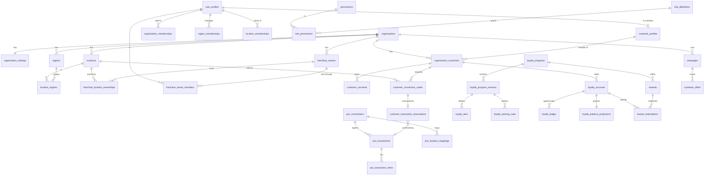

# Database

PostgreSQL 15+ (tested on 16). All objects live in schema `togiva`. Migrations: `packages/database/migrations/NNNN_name.sql`, forward-only, checksum-verified by `pnpm db:migrate`.

| Migration | Domain |
| --- | --- |
| `0001_foundation` | schema, runtime roles, request context, `touch_updated_at`, `prevent_mutation` |
| `0002_organizations_and_access` | organizations, settings, locations, regions, franchise ownership, users, roles, permissions, permission functions, role templates |
| `0003_customers` | global customer profile, organization membership, preferences, consents |
| `0004_governance_and_jobs` | audit, admin events, support access/export logs, integration errors, support cases, background jobs, rate limits |
| `0005_pos` | providers, connections, location mappings, webhook events, normalized transactions/items, customer mappings, sync, reconciliation, logs |
| `0006_loyalty` | programs, versions, tiers, earning rules, accounts, ledger, projections, qualification, rewards, eligibility, inventory, redemptions, adjustments |
| `0007_connection_codes` | codes, transaction associations, events, lockout/summary/expiry functions |
| `0008_campaigns_notifications_analytics` | campaigns, segments, offers, notifications, push subscriptions, daily metrics and aggregates |
| `0009_row_level_security` | grants, RLS policies for every table, connection-code transition guard |

## Conventions (required for new migrations)

- `id uuid default gen_random_uuid()` for entities; `bigint generated always as identity` for high-volume append-only logs.
- Every tenant table has `organization_id not null` and a `unique (organization_id, id)`; children reference parents with composite FKs.
- `timestamptz` everywhere; `created_at`/`updated_at` with the `touch_updated_at` trigger.
- Money: `*_minor bigint` + `currency char(3)`. Points: `bigint`.
- Status columns are `text` + `check (status in (...))`, mirrored by zod enums in `@togiva/shared-types`.
- Append-only tables get `before update or delete ... execute function togiva.prevent_mutation()`.
- Every new table: enable RLS and add explicit `togiva_app` grants/policies in the same migration (the RLS test fails otherwise).
- Never edit an applied migration; add a new one. Never put client-specific data in a migration.
- No partitioning yet. Candidates when volume justifies it: `loyalty_ledger`, `pos_webhook_events`, `customer_connection_events`, `audit_logs` (all time-ordered, append-only).

## ERD (core relationships)



## Local setup

```bash
createdb togiva_dev
psql togiva_dev -c "grant togiva_app, togiva_service to current_user"   # after first migrate creates the roles
DATABASE_URL=postgres://postgres@localhost:5432/togiva_dev pnpm db:migrate
DATABASE_URL=postgres://postgres@localhost:5432/togiva_dev pnpm db:seed:dev   # synthetic fixtures only
```

## Supabase notes

- Run migrations with the direct connection string as the `postgres` role; `create role` is permitted there. Grant `togiva_app, togiva_service` to the login the API uses.
- Do not add `togiva` to the PostgREST exposed schemas.
- `auth.users.id` is the `user_profiles.id`; there is deliberately no FK into `auth`, to keep the schema portable.
- Use the transaction pooler for the API; `SET LOCAL` keeps request context transaction-scoped, which is pooler-safe.
- Backups/PITR: enable PITR on staging and production; restore testing is Phase 8.
